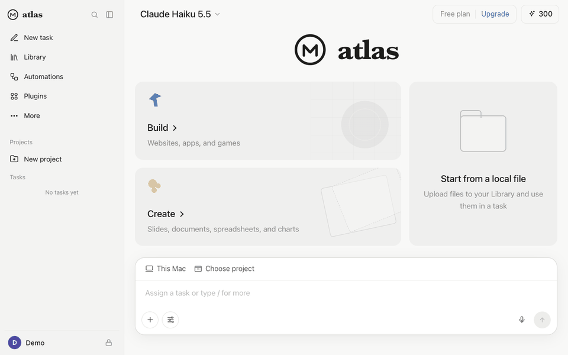

# Atlas: an autonomous AI agent you run yourself

Give Atlas a task. It makes a plan, searches and browses the web, runs code, and writes files on its own while you
watch it work live, then hands you the results. Powered by Claude.

**[▶ Try the live demo](https://andyww12345-atlas-demo.static.hf.space)** (read-only: open the example task in the
sidebar to watch a recorded run play back step by step).



*Sped up. **[▶ Watch the full run in real time](docs/atlas-demo.webm)** (about 2½ minutes, no sound): one sentence in,
a finished landing page out, on Claude Haiku 5.5 for about 2 cents.*

## What it can do

- **Do tasks end to end:** research with cited sources, data analysis, writing, coding, websites and documents. The
  plan appears as steps, and every action shows up as it happens.
- **Its own computer:** a "Computer" panel shows what the agent is doing: terminal output, files being written, and a
  real Chrome browser streamed live. Replay any step afterwards.
- **A real browser:** each task gets its own isolated Chrome session. The agent reads pages as numbered elements and
  clicks, types, fills forms, opens tabs and downloads files.
- **Asks before acting:** approval cards before anything irreversible (sending, buying, moving mail), a take-over mode
  where you drive the browser yourself (2-step codes, CAPTCHAs), and encrypted saved logins the AI never sees.
- **Build:** websites (templates, or start from an existing site), chatbots, mobile web apps, games, automations and
  Jupyter notebooks (executed, with charts, viewable in the app).
- **Create:** slides (themes, HTML or PowerPoint), documents, spreadsheets, visualizations, plus code-made designs
  (PNG), motion-graphics videos (WebM) and audio (narration and sound effects).
- **Library, Projects, Automations, Plugins:** reuse uploaded files, group tasks with shared instructions, run tasks
  on a schedule, from a webhook, or when a condition you describe becomes true, and connect apps over MCP.
- **Models and cost control:** switch between Claude Haiku 5.5, Sonnet 5.5 and Opus 5.5 at any time. A local
  credit budget (300 credits a day by default, 1 credit ≈ $0.01) stops tasks before they overspend.

## Quick start (your own API key)

You need Python 3.11+, an [Anthropic API key](https://console.anthropic.com/), and Google Chrome (or run
`.venv/bin/playwright install chromium` after the first start). Built and tested on macOS; Linux works except the
Mac-only voices used by Audio tasks.

```bash
git clone https://github.com/AndyWW214434/atlas-agent.git
cd atlas-agent
export ANTHROPIC_API_KEY=sk-ant-...
./run.sh
```

Then open http://localhost:8765. `run.sh` creates a virtual environment and installs the dependencies on first run.
For video tasks, also run `.venv/bin/playwright install ffmpeg` once.

All tasks are billed to **your** API key. The default model is Claude Haiku 5.5, the cheapest; change the default with
`AGENT_MODEL`, and set the daily credit budget under **Upgrade** (it only changes the local budget, nothing is charged).

## ⚠️ Safety

Run locally (`./run.sh`), Atlas runs shell commands and a browser **on the computer it is installed on, as your user.
They are not sandboxed.** Run it on your own machine for yourself, and only give it tasks you'd be comfortable running
yourself. Don't expose a local install to the internet: it has no user accounts, so anyone who can reach it could run
commands on your machine and spend your API key. To let other people use Atlas, deploy it in cloud mode (below), where
everyone signs in and every task runs in its own sandbox, or publish a read-only demo.

## Deploy to the cloud (accounts, sandboxes, spend limits)

In cloud mode, people create an account and each task runs on its own **E2B sandbox**: a small Linux VM in the cloud
with a terminal, files and Chromium. It pauses between messages and resumes where it left off. Accounts, tasks,
settings and saved logins live in **Supabase** (Postgres, Auth, Storage), and the web app and API run on **Render**.
AI usage is billed to your Anthropic key, within limits you set:

- every account gets `ATLAS_USER_DAILY_CREDITS` a day (default 100 ≈ $1), with no plans or top-ups;
- all accounts together stop at `ATLAS_GLOBAL_DAILY_CREDITS` a day (default 1000 ≈ $10);
- at most `ATLAS_MAX_SANDBOXES` tasks run at once (default 5), and one per person;
- a question the agent asks expires after 30 minutes, so no sandbox waits around for an answer.

Also set a monthly spend limit for the key in the [Anthropic Console](https://console.anthropic.com/) as a final backstop.

**1. Supabase** ([supabase.com](https://supabase.com), free plan)
- Create a project. In **SQL Editor**, paste and run [`supabase/schema.sql`](supabase/schema.sql): it creates the tables
  (locked with Row Level Security, so only the server can use them) and a private storage bucket.
- **Authentication → URL Configuration**: set **Site URL** to your Render address (step 3), e.g.
  `https://atlas-xxxx.onrender.com`, so confirmation emails link back to your app.
- **Authentication → Emails**: Supabase's built-in email sender only delivers to your own team's addresses and a few
  emails an hour. For sign-ups from anyone, add a free SMTP provider under **SMTP Settings** (e.g. Resend or Brevo),
  or switch off **Confirm email** under **Sign In / Providers** (simpler, but anyone can sign up with any address).
- **Project Settings → API Keys**: copy the **publishable** key and a **secret** key. The secret key only ever goes
  into Render's settings, never into the web page or git.

**2. E2B** ([e2b.dev](https://e2b.dev), free Hobby plan with starter credits)
- Copy your API key, then build the sandbox template once (a few minutes, runs in E2B's cloud):

```bash
.venv/bin/pip install e2b
E2B_API_KEY=e2b_... .venv/bin/python deploy/e2b_template.py
```

**3. Render** ([render.com](https://render.com), free plan)
- Push this repo to your GitHub, then **New → Blueprint** and pick it. [`render.yaml`](render.yaml) sets up a Docker
  web service and asks for the secrets: `ANTHROPIC_API_KEY`, `SUPABASE_URL`, `SUPABASE_PUBLISHABLE_KEY`,
  `SUPABASE_SECRET_KEY`, `E2B_API_KEY`, and `ATLAS_VAULT_KEY` (encrypts saved logins; generate one with
  `python -c "from cryptography.fernet import Fernet; print(Fernet.generate_key().decode())"` and keep a copy:
  losing it makes saved logins unreadable).
- When it's live, put its address into Supabase's Site URL (step 1) and sign up.

Free tiers have limits: Render's free service sleeps after 15 minutes without visitors (the next visit takes about a
minute, and scheduled automations don't run while it sleeps), a free Supabase project pauses after a week without
activity, and E2B's Hobby credits are used per second while a sandbox runs (paused sandboxes don't use them).
[`.env.example`](.env.example) lists every setting.

## Publish a read-only demo

The live demo above is a static site: no server, no AI calls, and no API key, so it costs nothing and visitors can't
spend anything. To make your own from tasks you've run:

```bash
.venv/bin/python deploy/build_static.py TASK_ID [TASK_ID ...]
```

This writes `deploy/static/`: the full interface plus the chosen tasks, with browser cookies, local paths and your
username removed (the script refuses to finish if any remain). Upload that folder to any static host, such as a free
Hugging Face **static** Space, GitHub Pages or Netlify. `deploy/build_hf.py` builds a Docker version of the same
read-only demo, for hosts that run containers.

## Record your own demo video

```bash
ATLAS_REDACT_USER=1 ATLAS_DATA=/Users/Shared/atlas-demo-data ATLAS_USER_NAME=Demo PORT=7863 ./run.sh
.venv/bin/python deploy/record_demo.py http://127.0.0.1:7863 docs
```

The first line starts a separate Atlas with empty data, so none of your own tasks appear on screen.
`ATLAS_REDACT_USER=1` hides your computer's username in terminal output, and the data folder sits outside your home
folder so file paths don't show it either. `record_demo.py` runs one real task (billed to your API key) and writes
`docs/atlas-demo.webm` plus a sped-up `docs/atlas-demo.gif`.

## How it works

| Path | Purpose |
|---|---|
| `app/agent.py` | Agent loop on the Claude API (streaming, adaptive thinking, tools), task state, persistence, live event bus, Build/Create modes |
| `app/tools.py` | Tool definitions and implementations: plan, ask user, shell, files, browser |
| `app/browser.py` | Per-task Chrome session (Playwright): numbered-element snapshots, tabs, downloads, live screencast, take-over, sign-in |
| `app/server.py` | FastAPI routes: tasks, live stream (SSE), files, library, projects, automations + scheduler, plugins, credits |
| `app/features.py` | Library, projects, automations, plugins (MCP connectors), credits |
| `app/vault.py` | Encrypted saved logins and connector tokens (key kept in the system keychain) |
| `app/media.py` | Renders HTML to PNG or video with headless Chrome (Design and Video tasks) |
| `app/computer.py` | Where tools run: this machine (local mode) or the task's E2B sandbox (cloud mode) |
| `app/sandbox_helper.py` | Runs inside each sandbox: file tools, the Chrome browser and its live view |
| `app/store.py` | Storage: JSON files under `data/` (local), or Supabase Postgres and Storage per user (cloud) |
| `app/auth.py` | Cloud sign-up and sign-in through Supabase Auth, kept in httpOnly cookies |
| `static/` | The web app: plain HTML/CSS/JS, no build step |
| `supabase/schema.sql`, `Dockerfile`, `render.yaml` | Cloud deployment |
| `deploy/` | The E2B sandbox template, and scripts that build the read-only demo (static site or Docker) |

Run locally, everything you create lives in `data/`, which is never committed: tasks and their files, Library uploads,
saved logins and browser cookies.

## License

MIT. See [LICENSE](LICENSE). Brand logos on the Plugins page come from [Simple Icons](https://simpleicons.org) (CC0);
the trademarks belong to their owners.
